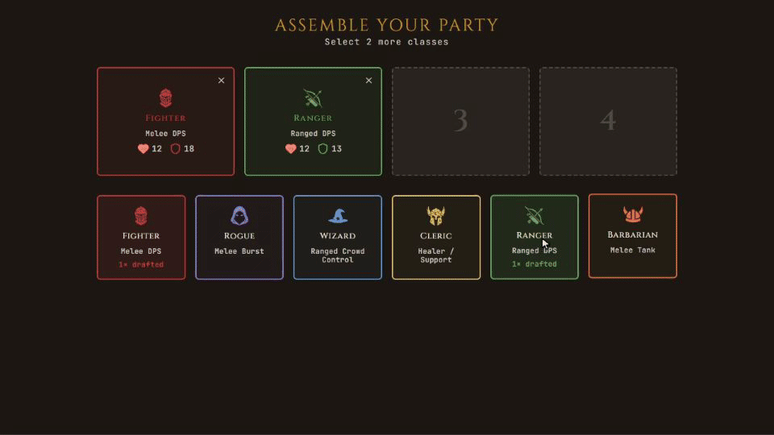
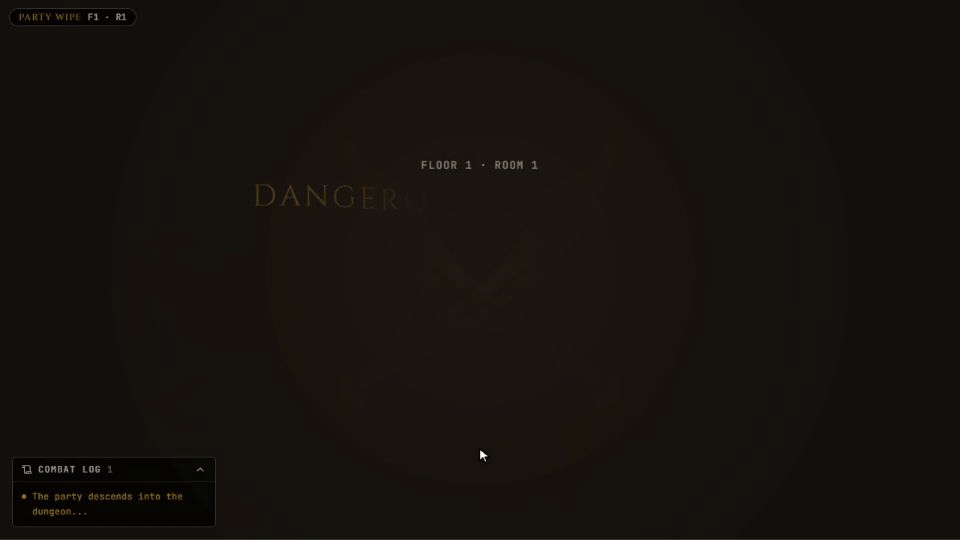
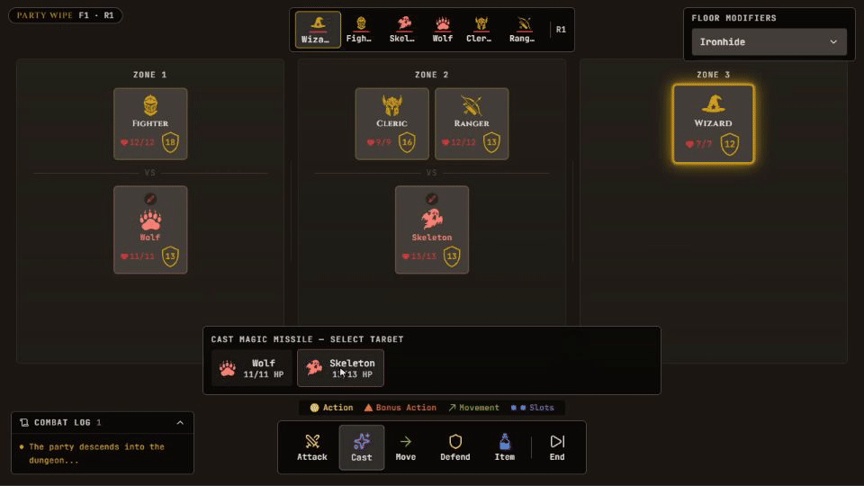

# Party Wipe

A solo D&D 5e roguelike on the SRD. Draft a party of four, walk room by room
into a dungeon that gets harder floor by floor, and see how far the party gets
before it wipes.

Play it at https://blue-sand-074984610.3.azurestaticapps.net.

## What it does

### Draft a party



Six classes, each with its own stats, weapon, armor and spells drawn from the
SRD. Every class opens to a full sheet, its stats, its combat kit and how it
grows level by level, before it joins the party.

### Rooms and floor modifiers



Each room is previewed before the party walks in: what kind of room it is, and
the floor's modifier, a twist on the rules that holds for the whole floor. One
gives every enemy more armor, another heals the party each turn, another stops
anyone changing zones. Every fifth room holds a boss.

### Zone combat



Combat plays out across three zones, with no grid. Where a combatant stands
decides what it can reach: a sword only strikes its own zone, a bow or a spell
reaches further. Each turn holds an action, a bonus action and a move. Spells
and weapons land conditions, such as paralyzed, restrained or burning, and
each one shows on the token it holds.

## How it plays

Initiative sets the order each round. Attacks roll a d20 against armour class and spells call for saving
throws, with damage types, resistances and immunities tracked as the SRD sets
them out. Between fights come loot, rests and level-ups. The run ends when the
last of the party falls, and the final screen counts the floors reached, the
rooms cleared and the enemies killed.

No sprites and no character art: the game is text, icons and tokens, with its
combat feedback and condition effects animated in CSS and Motion.

## Running it

The game lives in `frontend/` and needs Node 22:

```bash
cd frontend
npm install
npm run dev
```

Then open the dev server. `/` is the title screen and `/draft` builds a party.

`/dev` opens any screen directly for testing, with the party already drafted.
It also takes parameters, which the demo footage is recorded with:

| Parameter | Does |
|-----------|------|
| `seed=<any>` | Every roll, room, encounter and drop repeats from that seed |
| `phase=<id>` | Opens straight onto a screen, such as `room-preview` or `room-preview-boss` |
| `mod=<id>` | Sets a floor modifier, such as `ironhide` |
| `capture` | Hides the developer bars and lays the page out as the game does |

The footage itself is scripted in [`capture/`](capture/README.md).

Game data is committed, so regenerating it is only needed when the SRD subset
changes: [the development notes](docs/development.md#data-pipeline) set out the
pipeline.

## Data

All game data comes from the [5e Systems Reference Document](https://dnd.wizards.com/resources/systems-reference-document)
through the [5e SRD API](https://www.dnd5eapi.co/). A merge and seed pipeline
brings the 2014 and 2024 editions into one set of typed JSON.

## Documentation

| Document | Purpose |
|----------|---------|
| [docs/development.md](docs/development.md) | Project structure, data pipeline, architecture and conventions |
| [capture/README.md](capture/README.md) | Recording the demo footage |

---

This game uses content from the Systems Reference Document 5.1 ("SRD 5.1") by Wizards of the Coast LLC, available at https://dnd.wizards.com/resources/systems-reference-document. The SRD 5.1 is licensed under the Creative Commons Attribution 4.0 International License (CC-BY-4.0).
